# Adaptive Learnable Frequency Decomposition and Heterogeneous Large Core Convolution for Time Series Prediction Networks

\tPreface
\t\tAmong the existing wind power power prediction methods, Deep learning prediction framework based on signal decomposition has been widely used. The mainstream schemes mostly adopt CEEMDAN. VMD and other fixed decomposition algorithms as pre-processing steps: firstly, artificially split the original wind power sequence into different frequency bands. Reuse the same network to extract features and predict for all sub-components. This paradigm has two inherent limitations: first, Fixed decomposition rules are data-independent human priors. Cannot adaptively adjust the frequency band division according to the dynamic spectrum characteristics of wind power power at different time periods. Decomposition errors will be transmitted downwards. Directly harms subsequent predictive performance;Secondly, Different frequency components have completely different time-evolution rules. High-frequency noise perturbation components and low-frequency trend components affect the network receptive field. There are significant differences in the demand for modeling capabilities. It is difficult to meet the modeling needs of all bands with a prediction network that has the same structure. Furthermore, The mode of simple concatenated fusion lacks an adaptive decision mechanism for prediction tasks. The contribution of different frequency band components to the final power prediction results cannot be dynamically weighed. \t
In response to the above issues, this paper proposes ADF-ModernTCN-MoE: a wind power forecasting model based on adaptive learnable frequency filtering and heterogeneous ModernTCN expert hybrid. This model breaks away from the traditional research paradigm of "fixed algorithm preprocessing decomposition + unified predictor" by fully integrating frequency decomposition, specialized modeling in different frequency bands, and expert adaptive fusion into an end-to-end training framework. The model accomplishes dynamic spectral segmentation through input conditioning of an adaptive learnable filter group (ADF), liberating itself from the constraints imposed by traditional decomposition methods that require manual preset rules.Design a heterogeneous ModernTCN expert network with different effective receptive fields for signals in different frequency bands. Low frequency trends. Medium frequency cycle oscillation Differential modeling is implemented for high-frequency random perturbation components; Further combine the band energy with expert semantic state to realize hybrid expert dynamic routing. Complete the adaptive decision fusion for wind power power prediction. Conduct comparative experiments on public wind power datasets. Verify that the model can effectively capture the complex temporal characteristics of multi-frequency coupling of wind power. Improve prediction accuracy. This provides a new technical approach for wind power power prediction under high non-stationary scenarios.
We provide detailed materials, explanation documents, and video tutorials, including how to replace your own dataset, parameter tuning guides, etc. The code is commented line by line, with detailed introductions to parameters:
● Datasets: Wind power dataset from a wind farm, electric power dataset, wind speed dataset, etc.
● Environment framework: Python 3.11, PyTorch 2.1 and above are compatible for running.
● Model score: Test set 0.96
● Usage object: Paper requirements, graduation design requirements.
● Code guarantee: Code comments are detailed, ready to run without modification.
Click the bottom of the article to read the original text and get the code!
1 Innovative Model Introduction
\t1.1 Overall Process of the Model
\tADF-ModernTCN-MoE consists of three main stages:
\t (1)Adaptive Decomposition Filter (ADF): It transforms the input sequence into the frequency domain, combines static frequency priors and sample spectrum states, dynamically generates low/mid/high frequency soft masks, and maintains the spectral reconfigurability;
\t (2)Heterogeneous ModernTCN Experts: For different bands, assigns different convolutional receptive fields of ModernTCN-style experts, matching the model structure with the band attributes;
\t (3)Energy-Semantic Joint Router: Joins the energy of the band with the expert hidden representation, generating expert weights for each sample, dynamically integrating the predictions of various experts.
ADF-ModernTCN-MoE is an end-to-end adaptive frequency expert network for complex non-stationary time series prediction. The model first generates reconfigurable low/mid/high frequency soft decompositions in the frequency domain through Adaptive Decomposition Filter, jointly conditioning static band priors and sample conditioned spectrum states; subsequently, it configures ModernTCN-style heterogeneous convolutional experts with different effective receptive fields for different bands, enabling long-term structures in the low frequency and local fluctuations in the high frequency to match their frequency attributes; finally, it adaptively decides the contribution of each expert in the current sample through a dynamic router that fuses band energy and expert semantic representations. This framework unifies "how to divide frequencies, how to model each band, and how to make decisions" into an end-to-end optimization process driven by the prediction objective.
1.2 Innovation Points of the Model
Innovation Point 1: Sample-adaptive learnable decomposition for prediction tasks
Fixed VMD/DWT/STL/FFT band division uses the same decomposition rule for all samples, unable to dynamically adjust frequency boundaries based on the current sequence state, and the decomposition process usually cannot be directly driven by the final prediction error. ADF writes the frequency mask as an input conditioned function, meaning different samples can have different frequency divisions. The model can update the filters in end-to-end training through the predicted loss inversely, making "how to divide" directly serve "how to predict".
Innovation Point 2: Frequency-receptive field matching heterogeneous ModernTCN experts
\tTraditional MoE often uses multiple Experts with identical structures, only differing in input or parameters. While this achieves expert division of labor, it does not explicitly reflect the matching relationship between frequency patterns and convolutional receptive fields. ADF-ModernTCN-MoE sets different large kernels for different bands, i.e., the lower the frequency, the more need for a wider context aggregation; the higher the frequency, the more emphasis on local rapid changes. This step extends "band specialization" from the input layer to the model structure layer, allowing different experts to see different frequencies and possess different effective receptive fields.
\tInnovation\tPoint 3: Band Energy - Expert Semantic Joint Routing
If the router only relies on frequency band energy, high-energy bands may dominate for a long time. However, "high energy" does not necessarily imply "high predictive value"; conversely, if only hidden features are considered, it will overlook the true spectral composition of the current sample. Therefore, models jointly use physical/statistical intensity and deep semantic representations, allowing the Router to consider: how strong the current band is in the sample, and what predictive semantics the expert has extracted from that band. This allows the model to form different expert combinations for steady windows, windows with clear periodicity, and windows with rapid fluctuations.
2. Wind Power Power Data Set Introduction
2.1 Import data
The wind power dataset consists of 35,040 samples with 15 features. For visualization purposes, we will select the first 6,000 samples.
2.2 Dataset Preparation and Preprocessing
For detailed information, please refer to the provided documents!
3. High-innovation Predictive Model Based on ADF-ModernTCN-MoE
\t3.1 Define the ADF-ModernTCN-MoE prediction network model
3.2 Set parameters and train the model
50 epochs, MSE is 0.002089, ADF-ModernTCN-MoE prediction effect is significant. This model has a noticeable non-stationarity, multi-frequency coupling, and multi-variable interaction in long-term sequence prediction tasks. It no longer follows the traditional paradigm of "preprocessing with fixed decomposition algorithms, then passing all components to the same predictor". Instead, it integrates frequency decomposition, band-specific modeling, and expert adaptive fusion into a unified end-to-end prediction framework.
4 Results Visualization and Model Evaluation
4.1 Prediction result visualization
4.2 Model evaluation
4.3 Explanability analysis
ADF-ModernTCN-MoE is not only suitable for wind power power prediction but can also be extended to photovoltaic power prediction, power load prediction, equipment status prediction, transformer oil temperature prediction, and other multi-variable time series prediction tasks.
Click to download: Full original data, Python code
Previously interesting content:
Informer prediction model collection: Added feature importance analysis!
Fast Fourier Transform violent growth! Highly innovative time series classification model based on time-frequency feature fusion
STL-VMD secondary decomposition + Informer-LSTM parallel prediction model
Continue updates! Attention mechanism + lithium battery remaining life prediction collection
Direct writing in one area! CEEMDAN decomposition + Informer-LSTM +XGBoost combination prediction model
Based on Informer-SENet photovoltaic power generation power prediction comparison collection! Six sets of comparative prediction models, directly write for graduation theses and minor papers!
Based on ICEEMDAN+SHAP explainable analysis of lithium battery remaining life prediction high innovation model!
Based on Informer-BiGRUGATT-CrossAttention prediction model
High innovation! Based on ICEEMDAN+MSCNN-BiGRU-Attention parallel prediction model
High PM2.5 concentration air quality prediction model! A parallel prediction model based on VMD rolling decomposition + attention mechanism  
END  
\t2. Friends who like it can click to follow, give the article a "like", share in WeChat groups or discuss groups.

## Images

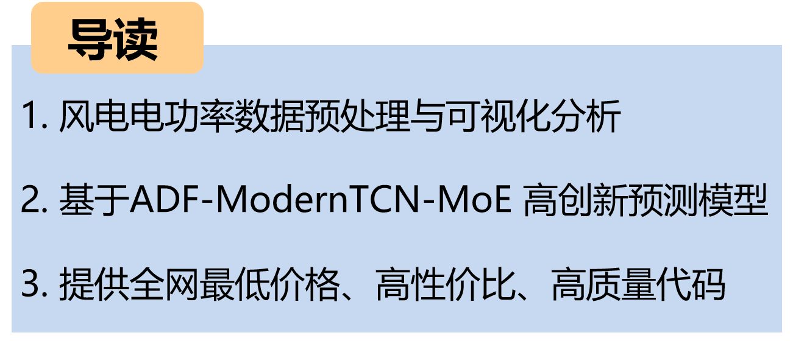
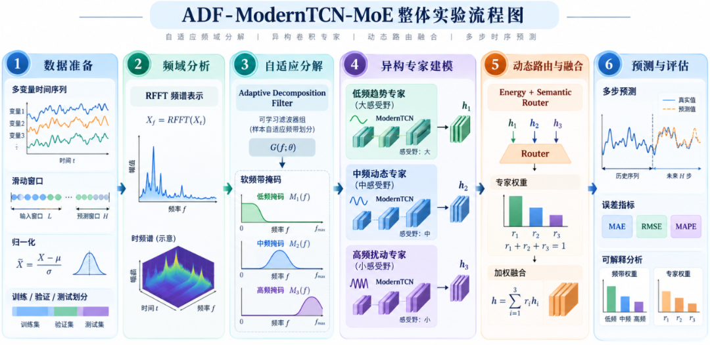
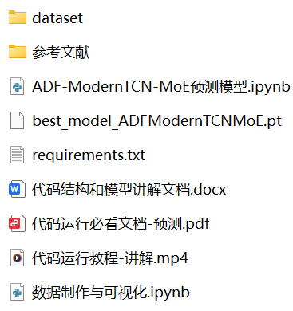
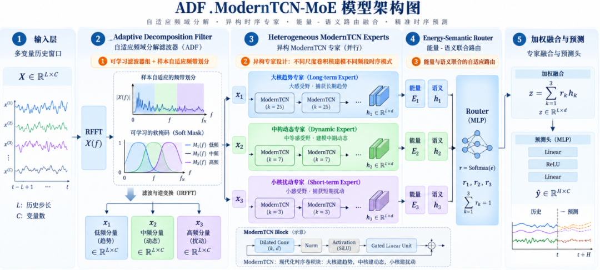
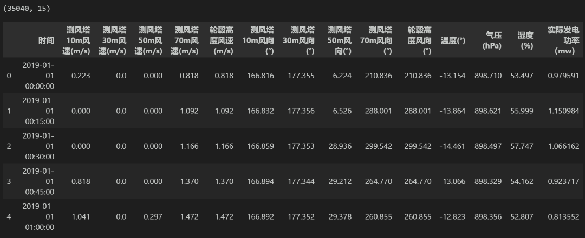

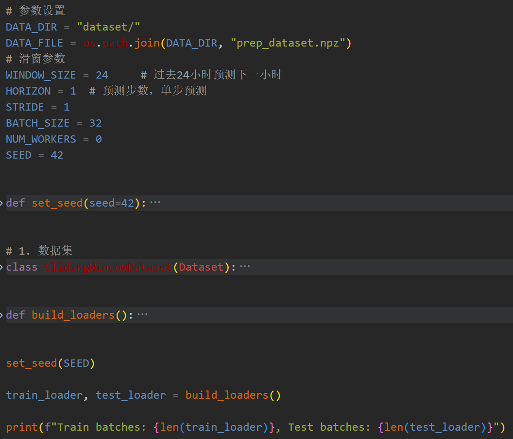
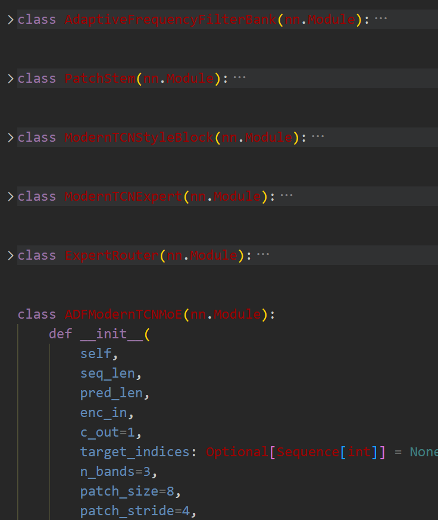
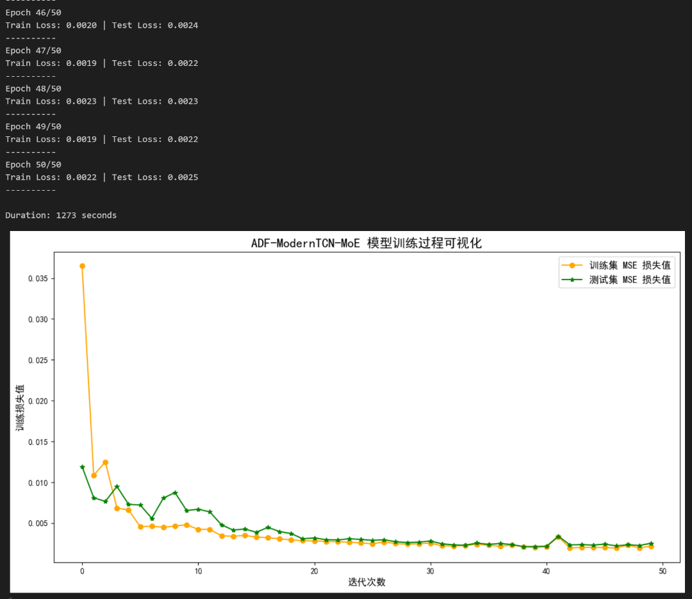
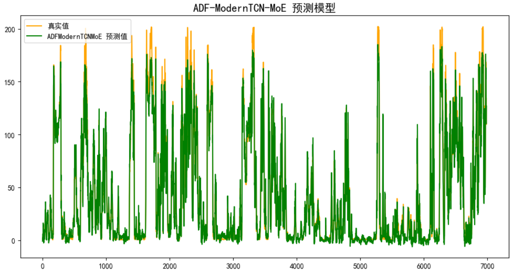
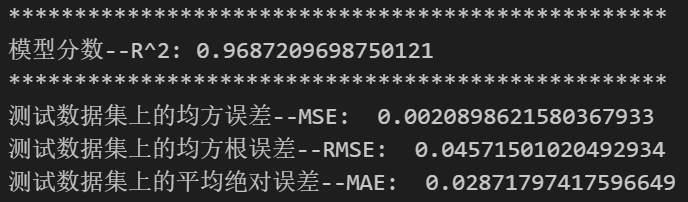
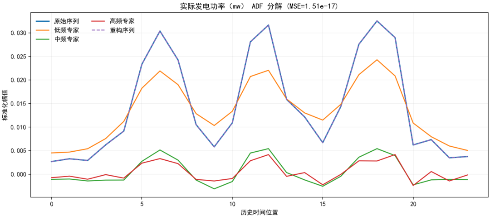
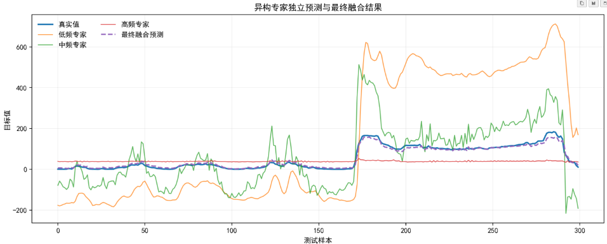

<!-- PAYMENT_BLOCK -->

## Get this dataset

- Payment link (Stripe): [Buy now](https://buy.stripe.com/3cs8yP7sY87d0vu9AB)
- Payment QR code: 

<!-- /PAYMENT_BLOCK -->
